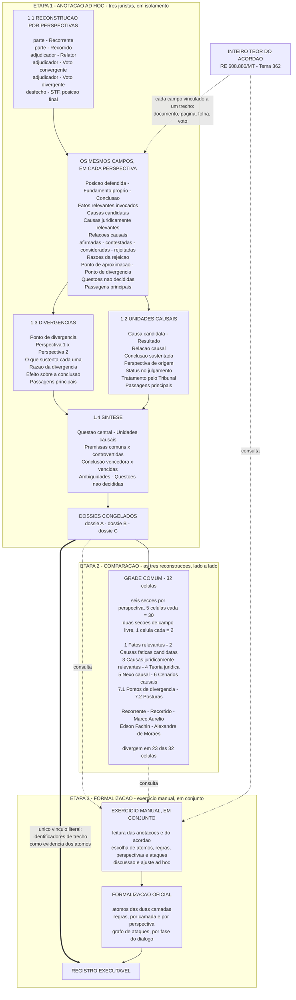
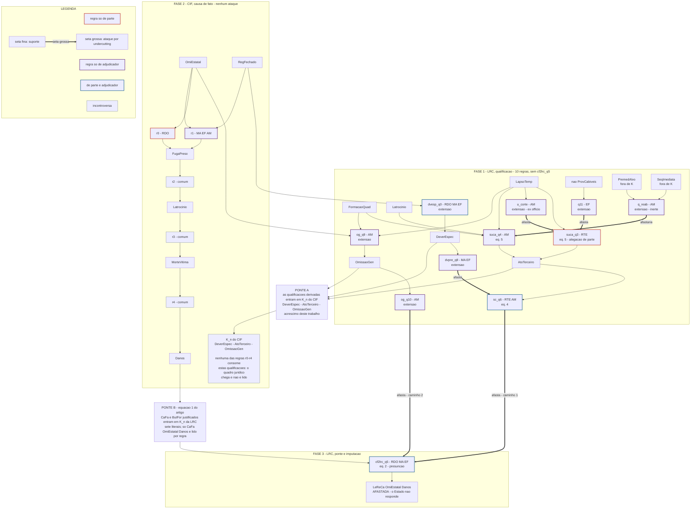

# Diagramas

## 0. Destino no artigo

Os dois diagramas deste arquivo são documentação de trabalho: registram o
conteúdo completo e não cabem, como estão, em figura de artigo. O mapa proposto
(numeração de tabelas e figuras conforme `plano-secao-4.md`, §II.T):

| Fonte aqui | No artigo | Forma recomendada |
|---|---|---|
| §1, etapas 1–3 | figura da 4.1 — pipeline compacto: três dossiês → grade de comparação → exercício manual conjunto → registro executável, com a distinção visual derivação (seta cheia) × consulta (seta tracejada) e o vínculo único de evidência | TikZ, meia coluna |
| §1, campos do formulário | não vira figura — a prosa de II.4.1 já os descreve | — |
| §2, ordem de execução (3 fases) | figura F3 da 4.4 — as duas ordens lado a lado (CIF→LRC × LRC→CIF→LRC), só blocos e pontes, sem conteúdo de regra | TikZ, meia coluna |
| §2, tabelas premissa/regra × perspectiva | tabela T4 da 4.3 | tabela LaTeX (booktabs), não figura |
| §2, grafo de ataques | figura F1 da 4.3 | Graphviz já gerado (`figures/case-003-final-lrc.*`), polir rótulos |
| §2, extensão fundada em 7 passos | prosa de II.4.3 (parágrafo da extensão fundamentada) | — |

Os blocos Mermaid abaixo são espelhos degradados dos ASCII — perdem o
alinhamento tabular e a distinção tipográfica entre suporte, ataque e consulta —
e não devem ser fonte de nenhuma figura. Para as figuras finais, gerar TikZ a
partir dos ASCII; para leitura rápida em docs, o ASCII é a forma canônica.

## 1. Anotação, consolidação e formalização

### ASCII

```text
  ╔════════════════════════════════════════════════════════════════════════╗
  ║ ETAPA 1 — ANOTAÇÃO AD HOC                 três juristas, em isolamento ║
  ╚════════════════════════════════════════════════════════════════════════╝

  1.1  RECONSTRUÇÃO POR PERSPECTIVAS

  ┌────────────────────────────────────────────────────────────────────────┐
  │ papel         perspectiva                                              │
  ├────────────────────────────────────────────────────────────────────────┤
  │ parte         Recorrente                                               │
  │ parte         Recorrido                                                │
  │ adjudicador   Relator                                                  │
  │ adjudicador   Voto convergente                                         │
  │ adjudicador   Voto divergente                                          │
  │ desfecho      STF — posição final                                      │
  └────────────────────────────────────────────────────────────────────────┘
                                      │
                      os mesmos campos, em cada perspectiva
                                      │
                                      ▼
  ┌────────────────────────────────────────────────────────────────────────┐
  │ Posição defendida    ·   Fundamento próprio    ·   Conclusão           │
  │ Fatos relevantes invocados                                             │
  │                                                                        │
  │ Causas candidatas                  ┐                                   │
  │ Causas juridicamente relevantes    ├──  afirmadas · contestadas ·      │
  │ Relações causais                   ┘    consideradas · rejeitadas      │
  │                                                                        │
  │ Razões da rejeição                                                     │
  │ Ponto de aproximação   ·   Ponto de divergência e sua razão            │
  │ Questões não decididas                                                 │
  │                                                                        │
  │ Passagens principais  ──────►  trecho do inteiro teor, com             │
  │                                documento, página, folha e voto         │
  └────────────────────────────────────────────────────────────────────────┘
                                      │
                                      ▼
  ┌─────────────────────────────────┐    ┌─────────────────────────────────┐
  │ 1.2  UNIDADES CAUSAIS           │    │ 1.3  DIVERGÊNCIAS               │
  ├─────────────────────────────────┤    ├─────────────────────────────────┤
  │ Causa candidata                 │    │ Ponto de divergência            │
  │ Resultado                       │    │ Perspectiva 1  ×  Perspectiva 2 │
  │ Relação causal                  │    │ O que sustenta cada uma         │
  │ Conclusão sustentada            │    │ Razão da divergência            │
  │ Perspectiva / origem            │    │ Efeito sobre a conclusão        │
  │ Status no julgamento            │    │ Passagens principais            │
  │ Tratamento pelo Tribunal        │    │                                 │
  │ Passagens principais            │    │                                 │
  └────────────────┬────────────────┘    └────────────────┬────────────────┘
                   └──────────────────┬───────────────────┘
                                      ▼
  ┌────────────────────────────────────────────────────────────────────────┐
  │ 1.4  SÍNTESE                                                           │
  ├────────────────────────────────────────────────────────────────────────┤
  │ Questão central                                                        │
  │ Unidades causais                                                       │
  │ Premissas comuns         ·   Premissas controvertidas                  │
  │ Conclusão vencedora      ·   Conclusões vencidas                       │
  │ Ambiguidades             ·   Questões não decididas                    │
  └────────────────────────────────────────────────────────────────────────┘
                                      │
                                      ▼
  ┌────────────────────────────────────────────────────────────────────────┐
  │ DOSSIÊS CONGELADOS      dossiê A  ·  dossiê B  ·  dossiê C             │
  └────────────────────────────────────────────────────────────────────────┘


  ╔════════════════════════════════════════════════════════════════════════╗
  ║ ETAPA 2 — COMPARAÇÃO                as três reconstruções, lado a lado ║
  ╚════════════════════════════════════════════════════════════════════════╝

           dossiê A               dossiê B               dossiê C
               │                      │                      │
               └──────────────────────┬──────────────────────┘
                                      ▼
  ┌────────────────────────────────────────────────────────────────────────┐
  │ GRADE COMUM                                          32 células        │
  ├────────────────────────────────────────────────────────────────────────┤
  │ 1  Fatos relevantes             5    Nexo causal                       │
  │ 2  Causas fáticas candidatas    6    Cenários causais                  │
  │ 3  Causas jurid. relevantes     7.1  Pontos de divergência             │
  │ 4  Teoria jurídica              7.2  Posturas                          │
  │                                                                        │
  │ seis seções por perspectiva, 5 células cada       =  30                │
  │ duas seções de campo livre, 1 célula cada         =   2                │
  │                                                                        │
  │ Recorrente · Recorrido · Marco Aurélio · Edson Fachin ·                │
  │ Alexandre de Moraes                                                    │
  │                                                                        │
  │ divergem em 23 das 32 células                                          │
  └────────────────────────────────────────────────────────────────────────┘


  ╔════════════════════════════════════════════════════════════════════════╗
  ║ ETAPA 3 — FORMALIZAÇÃO                   exercício manual, em conjunto ║
  ╚════════════════════════════════════════════════════════════════════════╝

  ┌────────────────────────────────────────────────────────────────────────┐
  │ BASE DE PESQUISA E CONSULTA                                            │
  ├────────────────────────────────────────────────────────────────────────┤
  │ dossiê A  ·  dossiê B  ·  dossiê C                                     │
  │ grade comparativa das três reconstruções                               │
  │ inteiro teor do acórdão                                                │
  └────────────────────────────────────────────────────────────────────────┘
                                      ╎
                                        consulta, sem derivação
                                      ╎
                                      ▽
  ┌────────────────────────────────────────────────────────────────────────┐
  │ EXERCÍCIO MANUAL, EM CONJUNTO                                          │
  ├────────────────────────────────────────────────────────────────────────┤
  │ leitura das anotações e do acórdão                                     │
  │ escolha de átomos, regras, perspectivas e ataques                      │
  │ discussão e ajuste ad hoc                                              │
  └────────────────────────────────────────────────────────────────────────┘
                                      │
                                      ▼
  ┌────────────────────────────────────────────────────────────────────────┐
  │ FORMALIZAÇÃO OFICIAL                                                   │
  ├────────────────────────────────────────────────────────────────────────┤
  │ átomos das duas camadas                                                │
  │ regras, por camada e por perspectiva                                   │
  │ grafo de ataques, por fase do diálogo                                  │
  └────────────────────────────────────────────────────────────────────────┘
                                      │
                                      ▼
  ┌────────────────────────────────────────────────────────────────────────┐
  │ REGISTRO EXECUTÁVEL                                                    │
  └────────────────────────────────────────────────────────────────────────┘

  ║  único vínculo literal entre a etapa 1 e a etapa 3: os identificadores
  ║  de trecho de um dos dossiês entram como evidência dos átomos, e cada
  ║  átomo segue rastreável até a página do acórdão


  ┌────────────────────────────────────────────────────────────────────────┐
  │ ▼   derivação        ▽   consulta, sem derivação        ║   evidência  │
  └────────────────────────────────────────────────────────────────────────┘
```
### Mermaid



### SVG


## 2. Formalização — átomos, premissas e regras, por perspectiva

### ASCII

```text
  ╔══════════════════════════════════════════════════════════════════════╗
  ║ PERSPECTIVAS                                                         ║
  ╚══════════════════════════════════════════════════════════════════════╝

  RTE   Recorrente — Estado do Mato Grosso           parte
  RDO   Recorrido — família da vítima                parte
  MA    Marco Aurélio, relator                       adjudicador
  EF    Edson Fachin, voto convergente               adjudicador
  AM    Alexandre de Moraes, voto divergente         adjudicador

  ●  sustenta     ·  não sustenta     comum  nenhuma perspectiva disputa


  ╔══════════════════════════════════════════════════════════════════════╗
  ║ ORDEM DE EXECUÇÃO —  LRC → CIF → LRC                                 ║
  ╚══════════════════════════════════════════════════════════════════════╝

  A camada de relevância roda duas vezes. Das onze regras dela, dez não
  leem literal de ponte e podem ser avaliadas antes dos fatos; só cf2lrc_q5,
  que lê CaFa, espera o resultado causal.

     fase 1   LRC, qualificação      10 regras, sem cf2lrc_q5
                   │
                   │  ponte A:  as qualificações derivadas entram
                   │            em K_n do CIF   —  acréscimo nosso
                   ▼
     fase 2   CIF, causa de fato     r0–r4
                   │
                   │  ponte B:  CaFa e ButFor justificados entram
                   │            em K_n da LRC   —  equação (1) do artigo
                   ▼
     fase 3   LRC, ponte e imputação   cf2lrc_q5 e o grafo completo

  A ordem do artigo é só CIF → LRC, com a ponte B. A ponte A é o que este
  trabalho acrescenta, e a Seção 4.4 mede o seu efeito.


  ╔══════════════════════════════════════════════════════════════════════╗
  ║ FASE 1 — LRC, qualificação                                           ║
  ╚══════════════════════════════════════════════════════════════════════╝

  entra    K_p da LRC:  OmiEstatal, RegFechado, LapsoTemp, FormacaoQuad,
                        Latrocinio, ¬ProvCabiveis
  roda     as dez regras que não leem literal de ponte

  deriva   DeverEspec       dever específico de custódia
           AtoTerceiro      causa superveniente independente
           OmissaoGen       omissão qualificada como genérica

  também conclui ¬suca_q3, ¬sc_q6 e ¬cf2lrc_q5 — nomes de regra, não
  fatos do mundo. Não atravessam a ponte A: o CIF não tem regra com esses
  nomes para sofrer undercut, e a fase 3 os rededuz por conta própria

  sai pela ponte A   DeverEspec · AtoTerceiro · OmissaoGen   →  K_n do CIF


  ╔══════════════════════════════════════════════════════════════════════╗
  ║ FASE 2 — CIF, causa de fato                                          ║
  ╚══════════════════════════════════════════════════════════════════════╝

  átomos
  ──────────────────────────────────────────────────────────────────────
  OmiEstatal     omissão estatal na custódia do preso     fato       K_p
  RegFechado     preso em regime prisional fechado        fato       K_p
  FugaPreso      fuga do detento                          intermed.
  Latrocinio     roubo seguido de morte pelo foragido     intermed.
  MorteVitima    morte da vítima                          intermed.
  Danos          danos materiais e morais à família       resultado

  K_n   AtoTerceiro, DeverEspec, OmissaoGen        vindos da fase 1
  K_p   OmiEstatal, RegFechado

  regras                                         RTE RDO  MA  EF  AM
  ──────────────────────────────────────────────────────────────────────────
  r0    OmiEstatal ⇒ FugaPreso                     ·   ●   ·   ·   ·
  r1    OmiEstatal ∧ RegFechado ⇒ FugaPreso        ·   ·   ●   ●   ●
  r2    FugaPreso ⇒ Latrocinio                     ●   ●   ●   ●   ●   comum
  r3    Latrocinio ⇒ MorteVitima                   ●   ●   ●   ●   ●   comum
  r4    MorteVitima ⇒ Danos                        ●   ●   ●   ●   ●   comum

  ataques nesta camada:  nenhum

  nenhuma das cinco regras lê AtoTerceiro, DeverEspec ou OmissaoGen — o
  quadro jurídico chega e não é consumido. É esse o achado da Seção 4.4

  sai pela ponte B   CaFa e ButFor de OmiEstatal, FugaPreso, Latrocinio
                     e RegFechado sobre Danos  —  sete literais


  ╔══════════════════════════════════════════════════════════════════════╗
  ║ FASE 3 — LRC, ponte e imputação                                      ║
  ╚══════════════════════════════════════════════════════════════════════╝

  átomos
  ──────────────────────────────────────────────────────────────────────
  LapsoTemp      crime três meses após a fuga             fato       K_p
  FormacaoQuad   crime em concurso de agentes             fato       K_p
  Latrocinio     roubo seguido de morte                   fato       K_p
  ¬ProvCabiveis  Estado não adotou as cautelas devidas    prova      K_p
  DeverEspec     dever específico de custódia             dever      fase 1
  OmissaoGen     omissão qualificada como genérica        dever      fase 1
  AtoTerceiro    causa superveniente independente         intermed.  fase 1
  PremedAlvo     crime premeditado contra alvo certo      fato       ✗
  SeqImediata    sequência imediata entre fuga e crime    fato       ✗
  MeiosDisp      Estado tinha meios materiais             prova      ✗

  ✗   em L e fora de K. PremedAlvo e SeqImediata são o distinguishing do
      RE 136.247, que a teoria do acórdão enuncia e estes autos não
      realizam; MeiosDisp é o requisito de meios do teste do dever, que
      voto nenhum chega a afirmar

  K_n   os sete literais de ponte vindos da fase 2; só
        CaFa(OmiEstatal, Danos) é lido por regra

  premissas de K_p                               RTE RDO  MA  EF  AM
  ──────────────────────────────────────────────────────────────────────────
  OmiEstatal                                       ·   ●   ●   ●   ●
  RegFechado                                       ·   ●   ●   ●   ·
  LapsoTemp                                        ●   ·   ·   ·   ●
  FormacaoQuad                                     ·   ·   ·   ·   ●
  Latrocinio                                       ●   ●   ●   ●   ●   comum
  ¬ProvCabiveis                                    ·   ·   ·   ●   ·

  regras                                         RTE RDO  MA  EF  AM
  ──────────────────────────────────────────────────────────────────────────
  dvesp_q0   RegFechado ⇒ DeverEspec               ·   ●   ●   ●   ·   ext.
  suca_q3    LapsoTemp ⇒ AtoTerceiro               ●   ·   ·   ·   ·   eq.5
  u_corte    LapsoTemp ⇒ ¬suca_q3                  ·   ·   ·   ·   ●   ext.
  suca_q4                                          ·   ·   ·   ·   ●   eq.5
             Latrocinio ∧ LapsoTemp ∧ FormacaoQuad ⇒ AtoTerceiro
  q_reab     PremedAlvo ∧ SeqImediata ⇒ ¬suca_q4   ·   ·   ·   ·   ●   ext.
  cf2lrc_q5  CaFa(OmiEstatal,Danos) ⇒ LeReCa(…)    ·   ●   ●   ●   ·   eq.2
  sc_q6      AtoTerceiro ⇒ ¬cf2lrc_q5              ●   ·   ·   ·   ●   eq.4
  dvpre_q8   DeverEspec ⇒ ¬sc_q6                   ·   ·   ●   ●   ·   ext.
  og_q9                                            ·   ·   ·   ·   ●   ext.
             OmiEstatal ∧ LapsoTemp ∧ FormacaoQuad ⇒ OmissaoGen
  og_q10     OmissaoGen ⇒ ¬cf2lrc_q5               ·   ·   ·   ·   ●   ext.
  q11        ¬ProvCabiveis ⇒ ¬suca_q3              ·   ·   ·   ●   ·   ext.

  eq.   esquema de Pisano et al. (2026)     ext.   extensão deste trabalho
  só cf2lrc_q5 é nova nesta fase; as dez restantes já rodaram na fase 1


  ╔══════════════════════════════════════════════════════════════════════╗
  ║ GRAFO DE ATAQUES — todos de undercutting                             ║
  ╚══════════════════════════════════════════════════════════════════════╝

  FASE DE ARGUMENTAÇÃO — partes
  ──────────────────────────────────────────────────────────────────────
  RTE    suca_q3 ⟹ AtoTerceiro ⟹ sc_q6      ⇏  cf2lrc_q5
         prevalece por default dialético: não recebeu réplica

  FASE DE DECISÃO — adjudicadores
  ──────────────────────────────────────────────────────────────────────
  MA     dvpre_q8                           ⇏  sc_q6
  EF     dvpre_q8                           ⇏  sc_q6
         q11                                ⇏  suca_q3
  AM     u_corte                            ⇏  suca_q3     ex officio
         suca_q4 ⟹ AtoTerceiro ⟹ sc_q6      ⇏  cf2lrc_q5   caminho 1
         og_q9 ⟹ OmissaoGen ⟹ og_q10        ⇏  cf2lrc_q5   caminho 2
         q_reab                             ⇏  suca_q4     inerte

  pontos sensíveis a preferência:  nenhum


  ╔══════════════════════════════════════════════════════════════════════╗
  ║ EXTENSÃO FUNDADA DA FASE 3                                           ║
  ╚══════════════════════════════════════════════════════════════════════╝

  1   dvesp_q0 não é atacada             DeverEspec         in
  2   dvpre_q8 dispara                   sc_q6              out    ✗ cam. 1
  3   u_corte e q11 disparam             suca_q3            out
  4   og_q9 dispara dos fatos postos     OmissaoGen         in
  5   og_q10 não sofre ataque            og_q10             in
  6   og_q10 undercuta a ponte           cf2lrc_q5          out    ✓ cam. 2
  7                          LeReCa(OmiEstatal, Danos)      out

  o Estado não responde — e a tese do dever específico, vencedora onde foi
  disputada, não decide o caso: o caminho 2 não passa por ela
```
### Mermaid



### SVG


